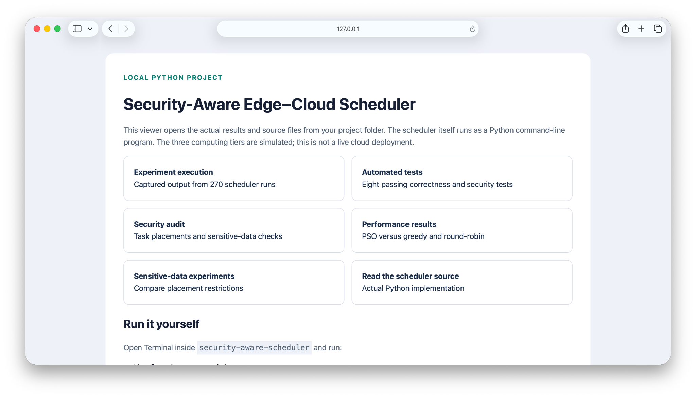
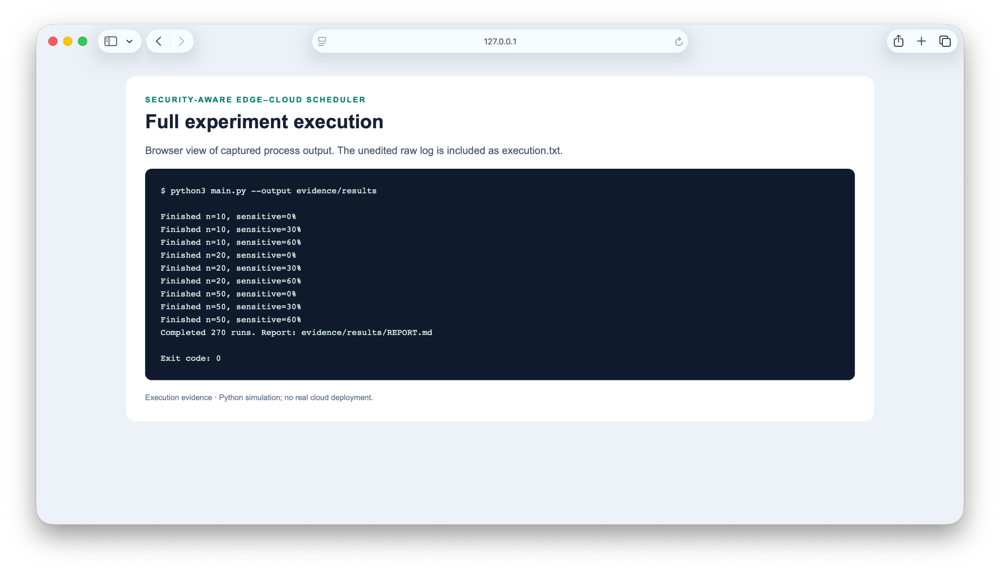
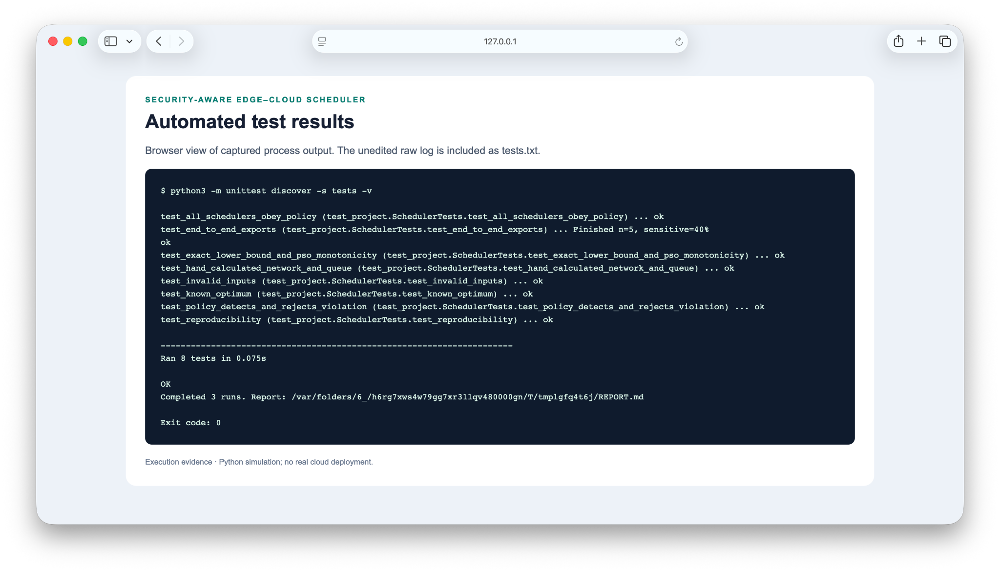
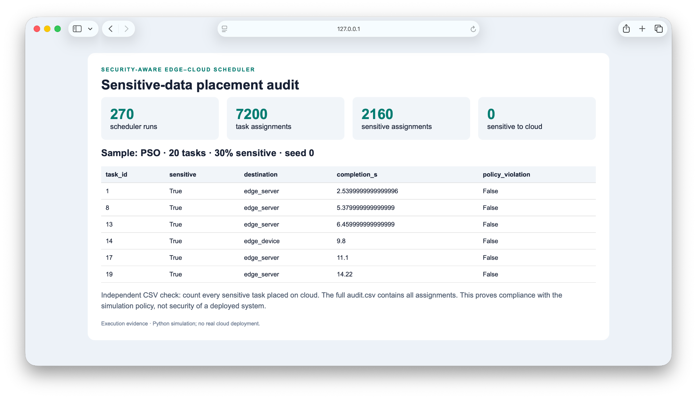
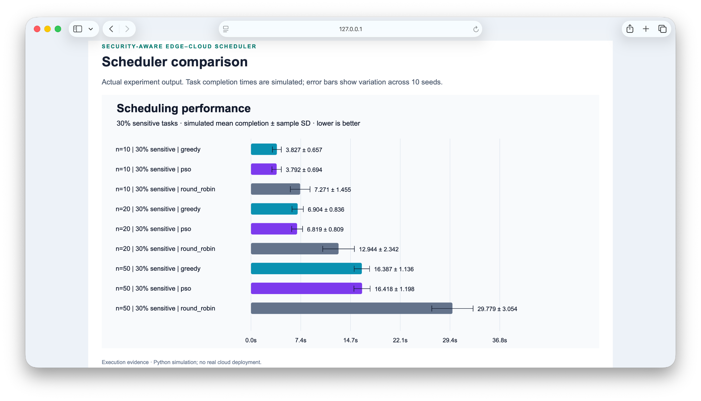
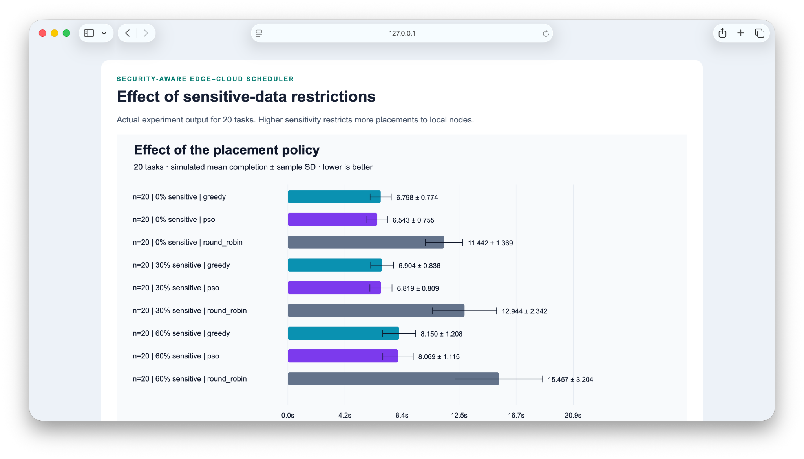
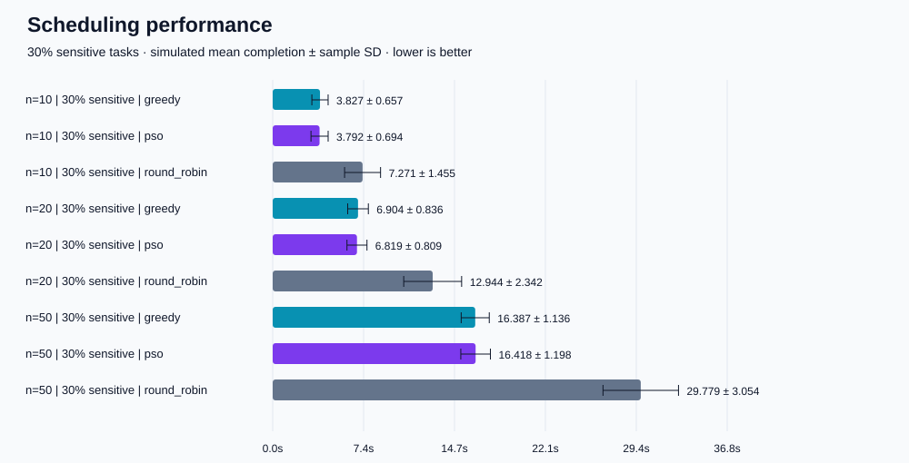

# Security-Aware PSO Task Scheduler

A small, reproducible Python university project exploring **where simulated AI inference tasks should run**: an edge device, an edge server or a cloud server.

Sensitive tasks can run only on trusted local nodes. The project compares **Particle Swarm Optimisation (PSO)** against **round-robin** and **greedy earliest-completion scheduling**.

**Python 3.10+ · No dependencies · No cloud account · Runs on a laptop**

> This is a simulation, not a deployed AI or cybersecurity product. No real inference model is executed. Processing speeds and network delays are illustrative assumptions. Security labels are supplied, not inferred.

## Project screenshots

Screenshots captured by Ammad Bajwa from the local project viewer. The images are included unchanged. They show simulator output, not a live cloud deployment.

### Project overview



### Full experiment execution



### Automated tests



### Sensitive-data placement audit



### Scheduler comparison



### Effect of sensitive-data restrictions



## Start in one minute

Download and extract the project, then open Terminal in its folder:

```bash
python3 main.py --quick
```

On Windows, use `python` instead of `python3` if needed. No pip install is necessary.

Run the complete experiment (270 scheduler runs):

```bash
python3 main.py
```

Open `results/REPORT.md` in your editor and `results/comparison.svg` in a browser. Outputs are regenerated in the chosen output folder. To keep a previous run, use a different folder:

```bash
python3 main.py --config configs/default.json --output results/my-experiment
python3 -m unittest discover -s tests -v
```

Commands assume your terminal is inside the project folder. A generated example run is included in [examples/results/REPORT.md](examples/results/REPORT.md).



## Research question

Can a small PSO scheduler improve average task completion time compared with simple baselines while enforcing sensitive-data placement restrictions?

There is no assumption that PSO wins. Negative findings and scheduler overhead are part of the evaluation.

## Model

All tasks arrive at time zero. Each task has 10–100 synthetic work units and a sensitivity label. Each node processes one task at a time; input order is preserved within each node.

| Node | Speed (work units/s) | Round-trip delay (s) | Trusted for sensitive tasks |
|---|---:|---:|---|
| Edge device | 10 | 0 | Yes |
| Edge server | 25 | 0.02 | Yes |
| Cloud | 50 | 0.10 | No |

The cloud is excluded by the **chosen local-data policy**, not because cloud services are inherently insecure. You can change trust and capacity in `configs/default.json`.

For each task assigned to a node:

```text
input_arrival = network_delay / 2
start = max(input_arrival, node_available_time)
compute_finish = start + work_units / speed
completion = compute_finish + network_delay / 2
node_available_time = compute_finish
```

Transfers may overlap and have no bandwidth contention. Return transmission does not occupy the compute worker. All queues drain, so completion rate is trivially 100%; we do not present it as a meaningful performance result. No deadlines, dynamic arrivals, task migration, cost or energy models are included.

## Schedulers

- **Round-robin:** cycle through nodes, skipping destinations disallowed for each task.
- **Greedy:** assign the next task to its earliest eligible predicted completion, updating the queue after every assignment.
- **PSO:** jointly search the assignment of the complete batch. One particle has one score per task per node. Each task selects the highest-scoring eligible node. This eligibility mask is a hard constraint.

The PSO velocity rule is:

```text
v = inertia*v + cognitive*r1*(personal_best-x) + social*r2*(global_best-x)
x = x + v
```

Default: 20 particles, 30 update iterations, inertia 0.7, cognitive/social coefficients 1.5. Velocities are clamped to [-2, 2], positions to [-5, 5]. A generation uses a snapshot of the global best. The initial population is randomly generated; there is **no greedy seed or hidden post-processing**. Initial evaluation plus 30 updates gives 620 candidate evaluations per workload. Fitness is mean simulated completion time. Task reordering is not optimised.

## Cybersecurity contribution

1. **Classification:** tasks carry normal/sensitive labels.
2. **Trust boundary:** sensitive tasks stay on configured trusted nodes.
3. **Enforcement:** every scheduler restricts assignments; evaluation rejects invalid placements.
4. **Audit:** a separate policy checker and per-task CSV record reveal assignments and violations.

The checker is tested with a deliberately invalid sensitive-to-cloud assignment. This is a placement-control demonstration, not encryption, authentication, intrusion detection or tamper-proof logging. See [the threat model](docs/THREAT_MODEL.md).

## Experiments and output

The default grid uses 10/20/50 tasks, 0%/30%/60% sensitivity, and 10 seeds: 90 workloads × 3 schedulers. Identical work sizes are preserved across sensitivity settings; each scheduler receives identical tasks. PSO uses a separate derived random seed.

| File | Contents |
|---|---|
| `runs.csv` | Per-run simulated mean/p95/makespan, policy violations and measured scheduling runtime |
| `summary.csv` | Scenario means and sample standard deviations across seeds |
| `tasks.csv` | Input tasks, labels and experiment identifiers |
| `audit.csv` | Every task placement and simulated timestamps |
| `convergence.csv` | PSO best fitness at initialisation and each iteration |
| `comparison.svg` | Scheduler comparison at 30% sensitivity by default |
| `sensitivity.svg` | Effect of sensitivity at 20 tasks by default |
| `exact_check.json` | Five-task exhaustive optimum and PSO gap |
| `REPORT.md` | Automatically generated methods, results and limitations |
| `config.json`, `metadata.json` | Run configuration, seeds, source hashes and Python/platform |

Charts show mean ± sample SD of per-run means, not confidence intervals. Maximum observed completion is the batch makespan, not a universal worst-case guarantee. P95 uses the nearest-rank definition.

Scheduler time is measured separately. `mean_with_scheduler_s` adds this one-off batch runtime to the simulated mean: a **hybrid estimate**, not measured remote latency. Results excluding scheduler time are deterministic for fixed code, seeds and configuration; measured runtimes vary.

## Project structure

```text
main.py                  Experiment runner and CLI
simulation.py            Tasks, nodes, queues and independent policy audit
schedulers.py            Round-robin, greedy, PSO and exact enumeration
reporting.py             CSV, SVG charts and generated Markdown report
configs/default.json     Editable experiment configuration
tests/test_project.py    Correctness, security and reproducibility checks
docs/                    Threat model and presentation guide
examples/results/        Actual generated sample results
.github/workflows/       GitHub Actions test workflow
```

## Tests

Run `python3 -m unittest discover -s tests -v` from the repository root. Tests cover hand-calculated timing and queue behaviour, policy violations, every scheduler's eligibility, known exhaustive optimum, PSO best-history monotonicity, deterministic seeds, invalid inputs and output generation.

The GitHub workflow runs tests on Python 3.10, 3.12 and 3.13 when uploaded. Local verification does not imply the hosted CI has already run.

## Put it on GitHub

Create an empty GitHub repository named `security-aware-scheduler`, then use the repository URL GitHub provides:

```bash
git init
git add .
git commit -m "Add security-aware edge-cloud scheduling simulator"
git branch -M main
git remote add origin YOUR_GITHUB_REPOSITORY_URL
git push -u origin main
```

Replace `YOUR_GITHUB_REPOSITORY_URL` before running that command. No repository owner or remote is preconfigured. If Git asks for your identity, configure your own name and email. Authentication is handled by your normal GitHub setup. Alternatively use GitHub's upload interface, preserving the folder structure; include `.github/workflows/tests.yml` to enable CI.

## Explain it at university

Use [docs/DEMO_GUIDE.md](docs/DEMO_GUIDE.md) for a short walkthrough. Read the code and adapt the experiments yourself; follow your university's rules on acknowledging AI-assisted work. The generated results are evidence from this simulator, not prior employment or deployed research experience.

## Research context

Inspired by the resource-management theme in [Polimi call 2026_IDR_DEIB_58](https://www.polimi.it/fileadmin/user_upload/Lavora-con-noi/allegati_incarichiricerca_proc_selettiva/2026_IDR_DEIB_58.pdf). This simplified independent educational implementation addresses placement and timing only; it does not reproduce the full research programme or imply affiliation.

## Future work

Dynamic task arrivals, uncertain processing estimates, bandwidth limits, measured ML inference and explicit energy/cost objectives can be added later. Keep the current version small enough to explain and validate first.

## Screenshots and execution evidence

See [evidence/README.md](evidence/README.md) for five browser screenshots, captured process logs, raw experiment outputs and SHA-256 checksums. These document actual local simulator runs.

## View locally

Open `index.html` in a browser to browse results and code. Alternatively run `python3 -m http.server 8765 --bind 127.0.0.1` inside this folder and visit http://127.0.0.1:8765/. The viewer displays saved outputs; execute `python3 main.py` to run the scheduler.
