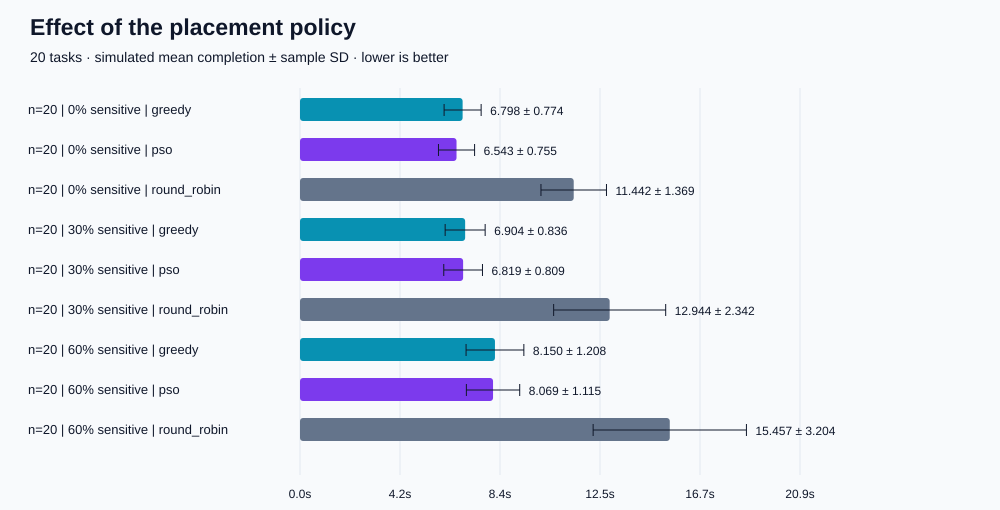

# Experiment report

Generated from this run. All task times are simulated seconds. Scheduler runtimes are measured on the executing machine.

## Method

All requests arrive together at time zero. Each worker has one execution slot. Input order is fixed within each worker; only destination assignment is optimised. Transmission takes half the configured round-trip delay in each direction, with no bandwidth contention. Both local nodes are trusted by assumption; sensitive data cannot be placed on untrusted nodes. Each algorithm receives exactly the same tasks for each scenario and seed. Sensitivity is assigned to a rounded number of tasks; actual counts are included in runs.csv. PSO uses random initialisation and optimises mean completion time only.

## Results

Across 90 paired workloads, PSO beat greedy 50 times, tied 2 times and lost 38 times (tolerance 1e-9 seconds).

Total policy violations: 0.

| Tasks | Sensitive | Scheduler | Mean completion (s) | SD across seeds (s) | Mean scheduler (ms) |
|---:|---:|---|---:|---:|---:|
| 10 | 0% | greedy | 3.6868 | 0.6489 | 0.019 |
| 10 | 0% | pso | 3.6384 | 0.7205 | 17.068 |
| 10 | 0% | round_robin | 7.0956 | 1.6079 | 0.008 |
| 10 | 30% | greedy | 3.8268 | 0.6575 | 0.017 |
| 10 | 30% | pso | 3.7920 | 0.6939 | 16.926 |
| 10 | 30% | round_robin | 7.2714 | 1.4553 | 0.007 |
| 10 | 60% | greedy | 4.6708 | 1.0286 | 0.017 |
| 10 | 60% | pso | 4.7110 | 1.0123 | 17.394 |
| 10 | 60% | round_robin | 8.4070 | 1.8182 | 0.007 |
| 20 | 0% | greedy | 6.7977 | 0.7741 | 0.033 |
| 20 | 0% | pso | 6.5431 | 0.7549 | 32.848 |
| 20 | 0% | round_robin | 11.4418 | 1.3693 | 0.012 |
| 20 | 30% | greedy | 6.9036 | 0.8361 | 0.031 |
| 20 | 30% | pso | 6.8186 | 0.8090 | 32.794 |
| 20 | 30% | round_robin | 12.9444 | 2.3419 | 0.013 |
| 20 | 60% | greedy | 8.1496 | 1.2077 | 0.030 |
| 20 | 60% | pso | 8.0693 | 1.1147 | 32.672 |
| 20 | 60% | round_robin | 15.4575 | 3.2039 | 0.013 |
| 50 | 0% | greedy | 16.2408 | 1.1754 | 0.077 |
| 50 | 0% | pso | 15.5815 | 1.3153 | 81.113 |
| 50 | 0% | round_robin | 25.7058 | 1.4870 | 0.026 |
| 50 | 30% | greedy | 16.3871 | 1.1356 | 0.074 |
| 50 | 30% | pso | 16.4177 | 1.1980 | 81.002 |
| 50 | 30% | round_robin | 29.7794 | 3.0544 | 0.028 |
| 50 | 60% | greedy | 19.4166 | 1.4695 | 0.082 |
| 50 | 60% | pso | 20.8983 | 1.8037 | 102.980 |
| 50 | 60% | round_robin | 34.5829 | 3.0970 | 0.030 |

## Tiny-instance exact check

For five tasks, the optimum is 2.180000s and PSO achieves 2.236000s (gap 2.569%). This is an exhaustive optimum over valid placements with fixed task order.

## Interpretation and limitations

PSO is a heuristic, not a guarantee of improvement. Greedy is a strong baseline for this simple model. The score-to-destination mapping is discontinuous and PSO can stagnate, especially as the task count grows. A higher sensitive fraction removes cloud choices, reducing available capacity; this is not encryption overhead.

Reported completion times exclude scheduler runtime to keep simulation outputs reproducible. The separate mean_with_scheduler_s field adds the measured one-off batch scheduling time to every task. It is a hybrid estimate, not measured distributed-system latency. Runtime varies by machine and timing noise.

No real inference, network, cloud billing or power measurements are performed. No energy or cost claims are made. The security mechanism is a simulated placement policy; it does not provide encryption, authentication, tamper-proof logs or protection against a malicious host or false sensitivity labels. The experiment uses synthetic batches, exact runtime estimates, no failures and no task migration. SD error bars describe seed variability, not statistical significance or confidence intervals.

## Reproduce

Use the command recorded in metadata.json with the saved config.json. Assignments and simulated metrics are deterministic for the same code, config and seeds; timing are not. Source SHA-256 hashes and Python/platform details are recorded in metadata.json.
